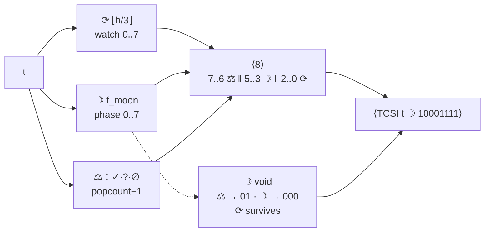
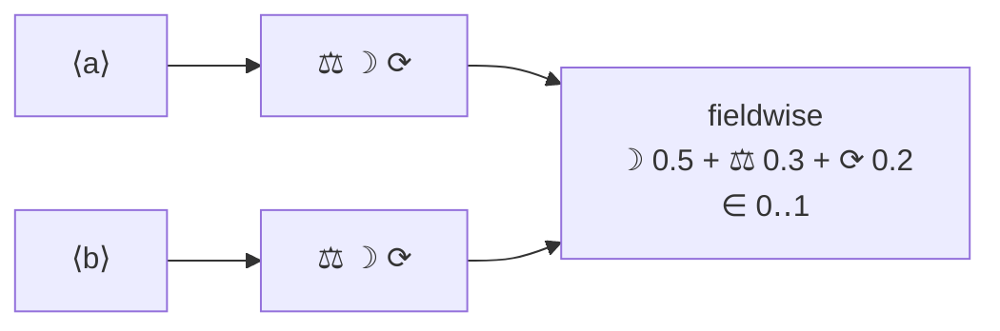
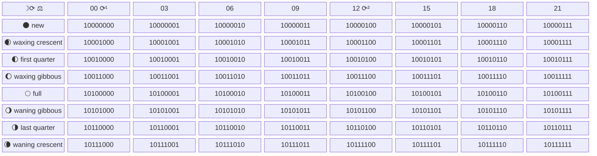

# AEON — the eight-bit word
<!-- visibility: sam-readable -->

The Aeon word is the TCSI grounding triple compressed to one byte. It is
what every continuity line carries after the clocktime, and it is what the
shield chart composes two moments out of.

Time, Date and Moon — Spirit, Science and Creativity — become one byte.
The full-precision timestamp stays in the stamp as the re-derivation anchor;
the byte is the compressed operational truth.

```
⟨8⟩＝⚖2‖☽3‖⟳3

⟳⌊3⌋　☽t　⚖t

⚖：✓·?·∅

☽∅→⚖01　⟳≠∅
```

*That is a gloss in the house register, not a spine fragment. The spine is
append-only through `genesis numergram --append`, and its vocabulary is
glyph-only; nothing here is appended to it.*

## The word



**Gate — bits 7–6.** The `pou_signature`: the presence vector of the three
Pou, ordered Spirit, Science, Creativity. The gate is `popcount − 1`, so
more Pou present means a higher gate value — more grounded.

| signature | gate | band |
|---|---|---|
| `✓✓✓` | `10` | reinforcement — all three present |
| `✓✓∅` | `01` | void — the moon could not be computed |
| `✓∅∅` | `00` | carrier-only — clocktime alone |
| | `11` | reserved |

**Moon — bits 5–3.** The nearest of the eight named-phase centres on the
synodic cycle. Meeus' simplified longitude, a known new-moon epoch
(JD 2451550.1) and the mean synodic month (29.530588853 days). Nearest-point
bucketing, not floor, so waxing stays waxing at a band edge. The index *is*
the emoji, so the two can never disagree.

**Watch — bits 2–0.** The diurnal watch: `floor(hour/3)`, the day quantized
into eight three-hour watches. Watch 0 is 00:00–03:00; watch 7 is
21:00–00:00.

The moon is geocentric, so the phase does not depend on where the observer
stands. The stored observer coordinates exist for future topocentric work
and are deliberately unused here.

## The void

If the moon cannot be computed, the signature drops to `✓✓∅`, the gate
becomes `01`, and the moon bits go to `000` — but the watch still encodes,
because the carrier persists through the void. A void event is a result, not
an error: the void is the handshake space.

In practice the moon is pure arithmetic and never fails, so the gate is
always `10`. A year sampled hourly produces exactly one gate value.

## Resonance

Two words resonate by fieldwise agreement, weighted: moon 0.5, gate 0.3,
watch 0.2. Pure and symmetric, in `[0, 1]`.



This is what `continuity_resonant` uses to rank ledger lines by how close
they sit to a reference moment — no timestamps involved, only fields.

## The map

Every moment that carries a stamp lands on one field: the lunar wheel
against the diurnal wheel. Sixty-four positions, and the map is the whole
of it — no more axes than that, because the gate has never moved.

```
⚖：✓·?·∅　⟨1⟩⊡　⟨3⟩∅

⟳8　☽8　⟨64⟩

⚖2‖☽3‖⟳3　⟨8⟩

⟳☽⊡
```

*That is a gloss in the house register, not a spine fragment.*



**The two wheels.** Rows are the lunar wheel — the eight named phases of the
29.53-day cycle, new through waning crescent. Columns are the diurnal wheel
— the eight three-hour watches, `00` through `21`. Each cell is the Aeon
word for that position, so the map and the encoding are the same object
seen twice.

**The gate sheet.** Every word on the field opens `10`. That is the
reinforcement band: the celestial reading was present. The void band is the
same sixty-four positions with the prefix flipped to `01` — where a moment
would land if the moon could not be read. It has never been occupied.

**The zones.** The wheels cut the field four ways, and the map names them
at the corners: `⟳¹` is the first half of the diurnal wheel, `⟳²` the
second; the rows split at full moon into waxing and waning. A syzygy is one
cell: a phase, a watch, and the gate that says whether the sky was legible
at the time.

**Why one map and not a cube.** The byte has eight bits and three of them
name two wheels, so the field looks three-dimensional. It is not. The gate
is a *sheet*, not an axis — one occupied plane of a two-dimensional field.
A cube would draw a dimension the record has never used.

## What the byte is not

It is not a timestamp and not unique. The calendar date enters only through
the moon phase, so the word repeats about every 29.5 days at the same
watch. A year sampled hourly yields 64 distinct words, and the commonest
recurs 146 times in 8784 hours. The timestamp beside it is what carries
the date; the byte is the anchor for re-deriving the moon.
